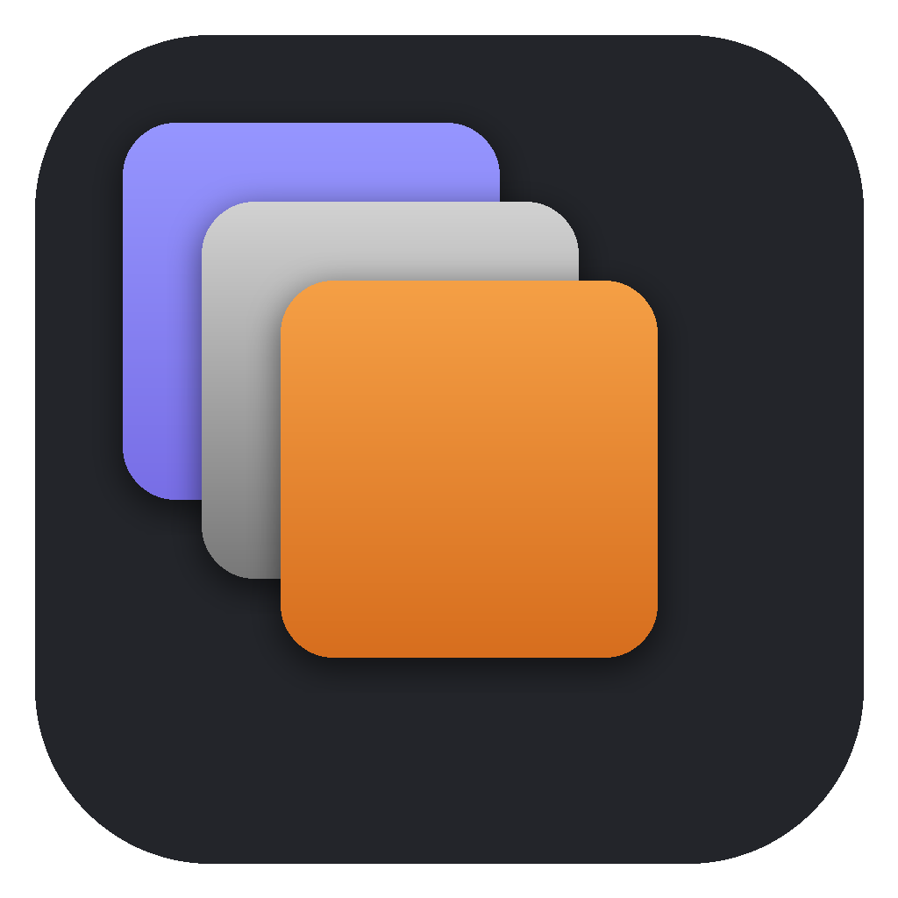

# HL Baker

A standalone high-to-low poly texture baker, modelled on Marmoset Toolbag's baker and powered by
Blender's Cycles renderer, which is bundled inside. Users don't need Blender installed.



## Features

- **Drag and drop meshes:** FBX, OBJ, glTF/GLB, PLY, STL, Alembic, USD, .blend
- **Quick-load bake groups** from names: `crate_low`, `crate_high`, `crate_high1`, `crate_cage`
  (`_lp/_hp`, `_lo/_hi` also work). Highs whose names don't match a low go to the low they overlap.
  Right-click a high poly to move it to another group.
- **Per-group cage offset and max ray distance**, or a custom cage mesh
- **14 maps:** Normal (tangent, OpenGL/DirectX), Normal (object), Ambient Occlusion (with *Ignore
  Groups*), Curvature (ray-traced or vertex), Thickness, Height, Position, Material ID, Object ID,
  plus Albedo / Roughness / Metalness / Emissive / Opacity taken from the high poly's materials
- **Anti-aliasing** by supersampling (1x / 4x / 16x), **edge padding** in pixels or fill the whole texture
- **Output:** one texture set or per group; PNG 8/16, TGA, TIFF 16, EXR 32
- **Live 3D viewer** (OpenGL): orbit around the low poly shaded with the baked maps, updated as
  each map finishes. Toggle the normal map and AO, inspect any single map or a UV checker, and
  show the high poly, the cage at each group's offset (updates live as you change it) and a wireframe
- **2D map viewer** (zoom/pan) and an offline **Cycles render** of the low poly with the baked maps
- **Projects** (`.hlbake`) save files, groups and settings
- **Command line** for batch and pipeline use
- **GPU baking** (OptiX / CUDA / HIP / Metal / oneAPI), falling back to CPU automatically

## Using the app

1. Drop your low and high files onto the window (or use **+ Low… / + High…**).
   A file's role is guessed from its name. Change it in the *Role* column if needed.
2. Check the groups. Set a **cage offset** large enough for rays to start outside the high poly.
3. Tick the maps, pick resolution, anti-aliasing and padding, and choose the output folder.
4. Click **Bake**. Each map appears on the model in the **3D Viewer** as soon as it's done.

**3D Viewer controls:** left-drag orbit, right- or middle-drag pan, wheel zoom, Shift+right-drag
rotate the light, F or double-click frame. Keys: N normal map, H high poly, C cage, W wireframe,
L low poly, 0–9 switch channel.

## Command line

The build includes `hlbake` (`hlbake.exe` on Windows) next to the app:

```
hlbake scan  props_low.fbx props_high.fbx
hlbake bake  props_low.fbx props_high.fbx -o bakes -n props -m game -s 2048 --aa 2
hlbake bake  --low lows.fbx --high highs.fbx -m normal,ao,curvature --directx -f EXR32
hlbake bake  -p myasset.hlbake                     # bake a saved project
hlbake bake  ... --set ao_distance=1.5 --set curv_radius=0.02   # any project setting
```

Map names: `normal normal_obj ao curvature thickness height position material_id object_id
albedo roughness metalness emissive opacity`, or `game` / `all`.

## Running from source

Needs **Python 3.13** (the `bpy` 5.2 wheel is built for it) on Windows x64, macOS Apple Silicon
or Linux x86_64.

```
python -m venv .venv
.venv/bin/pip install -r requirements.txt        # Windows: .venv\Scripts\pip ...
.venv/bin/python hlbake_main.py                  # app
.venv/bin/python hlbake_main.py bake ...         # CLI
```

## Building the app

```
pyinstaller --noconfirm hlbake.spec
```

The output is `dist/HLBaker/` (`dist/HLBaker.app` on macOS), about 1.1 GB unpacked and about 400 MB
zipped, mostly Blender and Cycles. PyInstaller can only build for the platform it runs on.
To build all three platforms, push this folder to a GitHub repository:
`.github/workflows/build.yml` builds Windows, macOS and Linux, smoke-tests each build (a real bake
and a GUI self-test), and attaches the zips to a GitHub Release whenever you publish one (or push a tag like `v1.0.0`).

**macOS:** the build is not code-signed. On first launch, right-click › Open, or run
`xattr -dr com.apple.quarantine HLBaker.app`.

## How it works

The window (PySide6, with an OpenGL 3.3 viewport through PyOpenGL) never loads Blender. Each scan, bake or preview runs in a separate worker
process (`hlbake worker …`) that imports `bpy`, so the UI stays responsive, **Cancel** kills a
bake immediately, and a crash in a bake can't take the app down. The engine (`hlbake/core.py`) is
the same one used by the Blender add-on in `blender_addon/hl_baker.py`.

Maps that Cycles doesn't bake natively are made by temporarily swapping the high poly's materials
for emission shaders (curvature from inside/outside occlusion probes, thickness from inside AO,
height from the high-vs-low position difference along the low normal). Each group's bake is
masked so groups can share one texture, and padding is applied afterwards (push-pull fill).

## Licence

GPL-3.0-or-later, because it bundles Blender (GPL). You can use it freely, including commercially,
and the textures you bake are yours. If you **distribute** the app, you must also make its source
available under the GPL.
